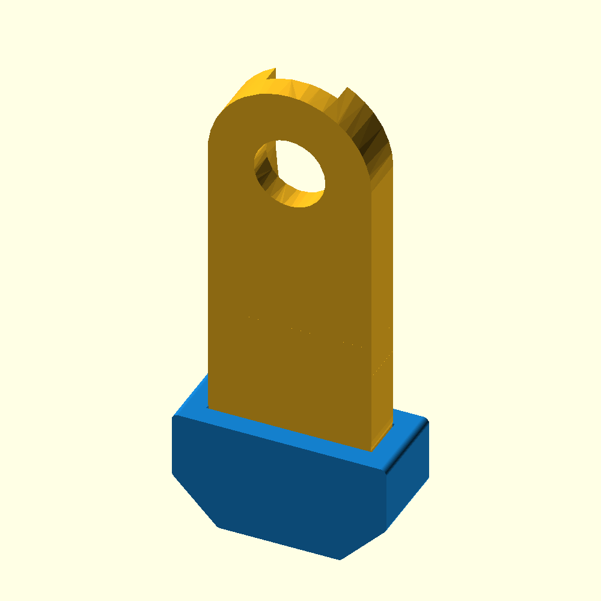

# Passive shoe prototype for hard, flat surfaces

These removable shoes fit over MicroHuli's rounded leg tips. They use the
existing four servos and add no joints or motors. The intention is to improve
traction on a table or hard floor. **Fit, retention, clearance and speed gain
have not been verified on a physical robot.**



## Files

- [One shoe](exports/rocker_shoe_single.stl) — print this first for a fit check.
- [Four shoes](exports/rocker_shoes_x4.stl) — default fit, 0.2 mm total clearance.
- [Three fit gauges](exports/fit_gauges.stl) — small sizing rings, not feet.
- [Editable OpenSCAD source](rocker_shoe.scad).
- [Shoe close-up](exports/shoe_preview.png).

## Geometry

The supplied original STL was measured at its assumed millimetre scale:
leg tip width approximately **16.01 mm**, thickness **4.6 mm**. This prototype
assumes the original parts were printed at **100% scale**.

| Feature                        |    Value |
| ------------------------------ | -------: |
| Shoe fore/aft length           |    21 mm |
| Shoe side-to-side width        |     9 mm |
| Shoe height                    |    11 mm |
| Nominal central sole thickness |     2 mm |
| Central flat contact length    |    12 mm |
| Default socket width           | 16.21 mm |
| Default socket thickness       |   4.8 mm |

The toe and heel have 45-degree bevels with rounded transitions. The socket
follows the lower rounded tip and opens upward. The fore/aft direction is in
the same plane as the leg's rotation. This is a friction-fit sleeve, not a
positive locking clip; retention depends on material and actual print fit.

## Material and fitting

- **TPU:** print a flexible shoe directly. Grip will depend on the TPU and floor.
- **PLA/PETG:** use the shoe as a rigid holder and add a thin rubber sole,
  approximately 0.5–1 mm thick. Bare hard plastic is not the traction upgrade.

Start with the fit gauges. With the layout viewed from above along its long
axis, the rings are ordered left to right by total clearance: **0.0, 0.2, 0.4 mm**.
Their openings are respectively 16.01 × 4.6, 16.21 × 4.8 and 16.41 × 5.0 mm.
Choose a snug fit that can be fitted without forcing or stressing the leg.
The shipped shoe STL uses the middle size. Change `clearance` in the source
and export again if another gauge fits better.

Print one complete shoe with its central sole flat on the bed and the socket
open upward. Initial slicer settings: 0.2 mm layers, three walls, 20–30% infill;
use your material's normal temperature and speed settings. A brim can help.
The geometry uses bevels to limit overhangs, but printability still needs a
slicer check. Confirm retention before making the other three shoes.

Fit the sole so it follows the flat central patch and toe/heel bevels. Keep
rubber, adhesive and straps out of the servo and moving leg joints. Added shoe
geometry changes folded-leg clearance: check that before using full DOWN/REST.

## Comparing walking speed

Use the same firmware, battery state and hard surface for both cases. Mark a
30 cm course away from a table edge. Record three runs with the original feet
and three with all four shoes, and compare travel times and visible slipping.
A wider sole can also increase return-stroke drag; a speed gain is not assumed.
After establishing the mechanical effect, gait frequency can be tuned separately.

The current firmware uses a 1.26 s gait period and a 3-command-degree/20 ms slew
limit. These files do not change that firmware.

## Export and geometry checks

```sh
openscad -o exports/rocker_shoe_single.stl -D 'part="shoe"' rocker_shoe.scad
openscad -o exports/rocker_shoes_x4.stl -D 'part="set"' rocker_shoe.scad
openscad -o exports/fit_gauges.stl -D 'part="fit"' rocker_shoe.scad
```

Exports were rendered and inspected. The single shoe is one closed manifold,
the four-shoe set contains four closed components, and the fit-gauge file
contains three closed components. The original leg mesh is imported only for
the assembly preview; it is excluded from the printable shoe exports.

Research context: a four-servo quadruped used rubber contact surfaces to improve
traction for forward velocity ([Iida and Pfeifer, 2006](https://people.csail.mit.edu/iida/papers/RASIidaPfeifer2006.pdf)).
That is evidence for testing traction, not validation of this shoe geometry or
an expected MicroHuli speed increase.
