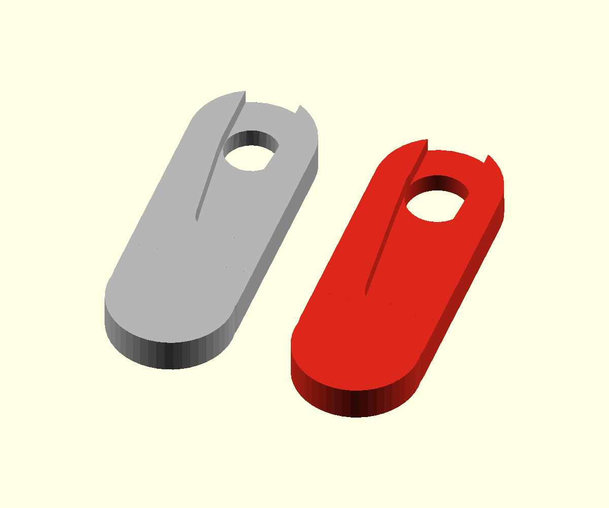
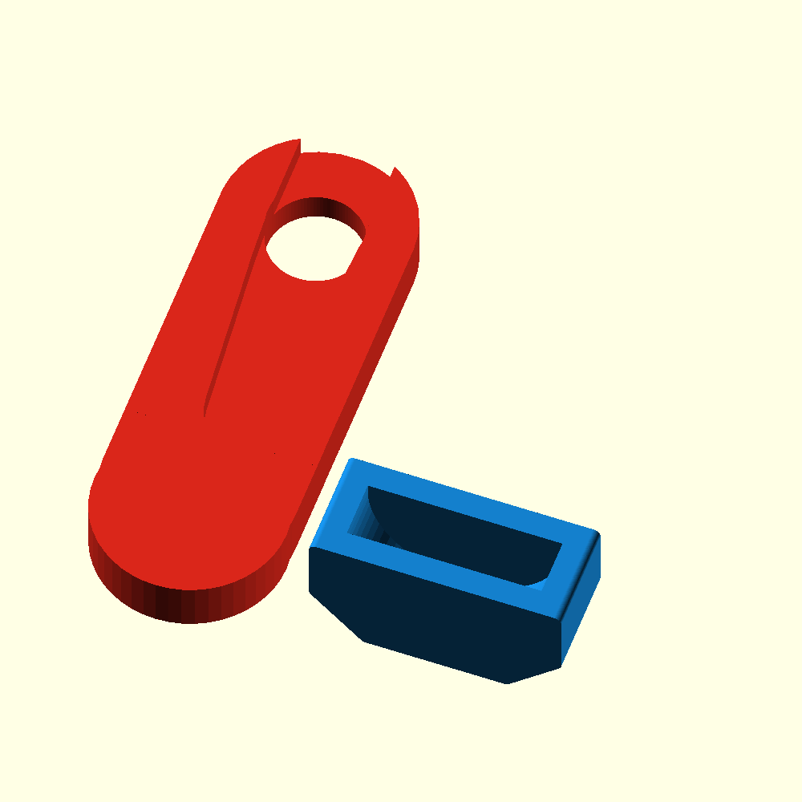

# Leg with a larger servo-horn mount

This version enlarges the printed recess around the servo horn and the circular
through-hole for hub/screw access. The arm recess now extends **5 mm farther
toward the foot** than the earlier enlarged-mount version, to accommodate a
longer horn. It keeps the original leg length, outside
outline, rotation centre and rounded foot. The original STL is preserved.



## Printable files

- [Small horn-fit sample](exports/horn_mount_fit_sample.stl): print first.
- [One complete revised leg](exports/leg_larger_horn_mount.stl).
- [Four revised legs](exports/legs_larger_horn_mount_x4.stl).
- [Editable OpenSCAD source](leg_horn_clearance.scad).

## Leg and shoe together in one print file

- [Test3 plus three revised legs and three shoes, one plate](exports/Test3_with_3_legs_and_shoes.3mf).
  This combines all four bodies from `inputs/Test3.3mf` with the
  latest 5 mm extended horn recess legs. Original dimensions, orientation and
  internal Test3 offsets are preserved; only whole-group placement changes.
  The print envelope is about 130.5 × 113.72 × 27 mm, with a 10 mm gap between
  Test3 and the leg/shoe row. This is a geometry 3MF: select your printer,
  material and process in the slicer before slicing. It contains no G-code.
  Archive/mesh checks and a QIDI Studio CLI import passed. All seven build
  groups rest on Z=0 and their bounding boxes do not overlap; Test3's four
  original bodies remain grouped together. Slicing has not been run.
  Regenerate with `python3 combine_test3.py`; the original input is retained
  in `inputs/Test3.3mf`.

- [One revised leg plus one separate shoe](exports/new_leg_and_shoe.stl).
- [Three revised legs plus three separate shoes](exports/new_legs_and_shoes_x3.stl).
- [Four revised legs plus four separate shoes](exports/new_legs_and_shoes_x4.stl).
- [Editable print layout](leg_and_shoe.scad).

The leg and shoe are spaced apart in these files and both rest on the bed.
Print at 100% scale, then slip the shoe over the rounded leg tip. These files
use the enlarged horn mount above and the existing shoe's 0.2 mm total socket
clearance. Start with one pair to check both fits. For one material in a single
job, use PLA/PETG and add a thin rubber sole; for a flexible TPU shoe, use the
individual leg and shoe files in separate material jobs.



Regenerate this layout after exporting the individual designs:

```sh
openscad -o exports/new_leg_and_shoe.stl -D 'part="pair"' leg_and_shoe.scad
openscad -o exports/new_legs_and_shoes_x3.stl -D 'part="set3"' leg_and_shoe.scad
openscad -o exports/new_legs_and_shoes_x4.stl -D 'part="set"' leg_and_shoe.scad
```

| Feature                        |            Original |             Revised |
| ------------------------------ | ------------------: | ------------------: |
| Recess clearance               |            Baseline |    +0.4 mm per side |
| Straight upper slot width      |        About 7.0 mm |        About 7.8 mm |
| Centre-to-tip arm recess reach |       About 16.1 mm |       About 21.5 mm |
| Circular through-hole diameter |        About 7.0 mm |              8.0 mm |
| Recess depth from the top face |        About 2.0 mm |        About 2.0 mm |
| Complete leg envelope          | 16.01 × 45 × 4.6 mm | 16.01 × 45 × 4.6 mm |

The 5 mm extension stretches the tapered arm pocket below the fixed servo
centre; it does not move the bore or lengthen the leg. The listed 21.5 mm reach
includes the 0.4 mm tip clearance. The 8 mm bore is in the **printed leg**, not in the servo horn's splined
socket. These changes are a first fit allowance based on the original mesh;
the photograph cannot establish the actual horn's dimensions.

## Print and fit

1. Print the fit sample at **100% scale**, flat back on the bed, recess facing
   upward. Start with 0.2 mm layers and three walls; supports should not be
   needed in this orientation. The supplied files are already oriented this way.
2. With servo power off, try an untrimmed spare horn in the recess. It should
   sit flat without force, with its hub aligned with the circular opening.
   Check arm length, width, thickness and screw access. The sample has a cut
   end and is for fit checking only.
3. If the fit is good, print one full leg and check its attachment and free
   movement before printing the rest. Retain the original horn fastening
   method; the enlarged recess is clearance, not a press-fit retainer.

If the horn is still tight, adjust `pocket_extra` in the SCAD file. This value
is **per side**: 0.5 adds 1 mm to the total slot width. `access_diameter` controls
the through-hole separately, and `pocket_extension` controls extra length toward
the foot (default 5 mm). The shortened fit sample includes the full extended
recess and is now 31 mm long. The default recess depth is unchanged; a horn
that is too thick needs a separate depth adjustment after measuring it.
Do not enlarge the horn's spline or the servo shaft socket.

The unchanged rounded tip also fits the dimensions used by the
[passive shoe prototype](../feet/README.md).

## Regenerate

Run from this directory with OpenSCAD installed:

```sh
openscad -o exports/horn_mount_fit_sample.stl -D 'part="fit"' leg_horn_clearance.scad
openscad -o exports/leg_larger_horn_mount.stl -D 'part="leg"' leg_horn_clearance.scad
openscad -o exports/legs_larger_horn_mount_x4.stl -D 'part="set"' leg_horn_clearance.scad
```

The source joins an approximately 0.002 mm gap between the original mesh's
upper and lower leg sections inside their existing outline. Export checks
found one closed component per leg/sample, four in the set, and every mesh
edge shared by exactly two triangles. All exports were rendered and inspected.
Physical horn fit, fastening and printed strength remain to be checked.
