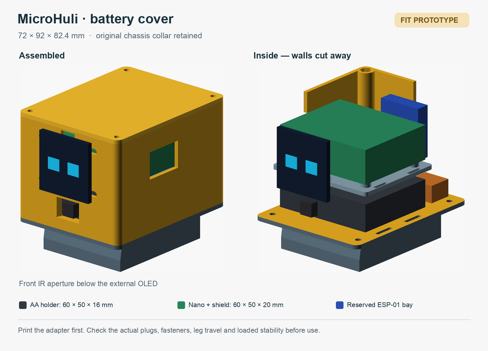

# Larger MicroHuli battery cover

A four-part replacement cover for the existing MicroHuli servo chassis. The
owner measured the loaded four-AA holder as **60 × 50 × 16 mm**, and the Nano
installed in the Hailege Nano I/O shield as **60 × 50 × 20 mm**. These supersede
the earlier packaging/unit values. Measurements do not establish connector
positions or circuit behavior.



The printed assembly is **72 × 92 × 82.4 mm**, excluding the external OLED,
fastener heads and cables. The existing cover was approximately 55 × 68 × 31 mm.
The lower **18 mm** of its original, unscaled shell is retained in a chassis
adapter. Above it, the holder sits below a removable controller tray. The IR
receiver faces an opening below the external OLED. A rear bay reserves space
for a future upright ESP-01 and separate supply/level-shifting electronics.
Colored blocks in the preview are component envelopes; only the battery-holder
and populated-shield dimensions were supplied by the owner. The OLED, receiver
and future electronics are illustrative, not measured part models.

## Parts and assembly

| Part      | Print envelope, mm | Purpose                                                             |
| --------- | ------------------ | ------------------------------------------------------------------- |
| `adapter` | 72 × 92 × 20.4     | Original lower shell profile plus flange; test on the chassis first |
| `tub`     | 72 × 92 × 59.6     | Battery pocket, controller rails, IR ties and future-module shelf   |
| `tray`    | 66 × 56 × 5.4      | Removable shield support with 3 mm insulating pads and tie slots    |
| `lid`     | 72 × 92 × 4.0      | Removable top, including a 1.6 mm locating skirt                    |

1. Print **only the adapter first**, in the supplied orientation, and try it on
   the existing chassis with power disconnected. Keep the existing retention
   method. The original lower profile is preserved; printed fit is unverified.
2. Join the tub floor to the adapter flange with **four M3 × 8 mm bolts and
   four M3 nuts**. Nuts are accessible outside the original collar. Confirm
   actual bolt/head clearances before loading the battery holder.
3. Install the loaded holder in its **62 × 52 mm** pocket: 1 mm clearance per
   side around the measured holder. Use nonconductive retaining straps through
   the aligned tub/adapter floor slots. Route its leads through the end gaps;
   do not pinch them.
4. Place the shield on the tray's insulating pads. Secure it through the tie
   slots using suitable unpopulated PCB edges, without pressing on components,
   header pins or solder joints. Rail reliefs leave 2 mm below the tray for
   thin retaining bands; keep bulky tie heads away from the rails. Add
   insulating sheet/foam if required by the actual underside. Exact board mounting holes were not measured or invented.
5. Lower the tray onto its side rails and end stops. The holder's top is at
   Z=38.8 mm, tray underside Z=44.8 mm, and controller envelope Z=50.2–70.2 mm.
   There is **6 mm below the tray** and **9.8 mm above the controller** for
   clearance; check the complete wire harness, especially header plugs.
6. Mount the receiver inside the front wall with its sensing face flush with,
   or within approximately 1 mm behind, the **16 × 12 mm open aperture**.
   Use the two internal tie tabs. Receiver PCB dimensions are still a fit check.
7. Use the front slots for an external OLED bracket: each side adjusts from
   **12 to 19 mm** away from center, at **Z=47 and 72 mm**. This supports hole
   spacing of 24–38 mm horizontally and 25 mm vertically; the exact OLED hole
   pattern remains unverified. Adapt the bracket/parameters if yours differs.
   The OLED cable passage is 10 × 4 mm. No existing OLED board is modified.
8. Seat four standard M3 nuts in the top hex recesses and fit the lid with
   **four M3 × 10 mm bolts**. Recesses are 5.8 mm across flats, 2.8 mm deep;
   check your nuts on a test print. Remove lid and tray to change batteries.

The two **24 × 16 mm side service openings** have adjustable Y/Z locations in
`cover.scad`. They provide access space, not a confirmed USB/DC-jack alignment.
Check the actual shield orientation and plugs before printing the tub. Openings
also need to pass preassembled cables; neither this cover nor its IR opening is
waterproof.

## Infrared and future Wi-Fi

The IR receiver can be inside, but the optical path must remain open. Do not
cover the aperture with ordinary PLA/PETG or assume clear-looking plastic passes
infrared. A qualified IR-transparent window is an alternative. Keep its lens
close to the aperture and test reception from several directions; window size
and lens distance affect viewing angle. See [Vishay mechanical design notes](https://www.vishay.com/docs/80075/mechnote.pdf).

The rear shelf is approximately **32 × 14 mm**, at Z=40 mm, with tie slots for
an upright module. An illustrative **26 × 8 × 30 mm** ESP-01/connector envelope
and a **16 × 14 × 10 mm** power/level-shifter envelope fit without CAD collisions;
actual modules/adapters must be measured. Orient the antenna toward the rear
plastic wall, away from batteries, shield metal, nuts and bundled cables. Keep
about 15 mm free of metal around the antenna where the module design requires
it, and verify the chosen module's antenna placement and range. This bay does
not establish RF qualification. See [Espressif hardware guidelines](https://documentation.espressif.com/esp8266_hardware_design_guidelines_en.html).

Reserve a suitable **regulated 3.3 V supply** and logic-level conversion for the
future ESP-01. Do not connect 5 V Nano TX directly to an ESP input or assume the
shield's 3.3 V rail can supply Wi-Fi peaks. Power routing on this exact Hailege
shield remains unverified; its DC jack does not establish a safe input voltage.
Do not connect the raw four-cell pack to the Nano's 5V/3V3 pins. Follow the
existing [firmware wiring notes](../../../firmware/MicroHuli/README.md#wiring)
and [ESP-01 setup guide](../../../docs/guides/SERIAL_DEVICES.md#esp-01-standalone-gateway).
Mechanical space does not replace the supply/level-shifter design.

## Generate and print

Install OpenSCAD and put `openscad` on PATH. From the repository root:

```sh
python3 hardware/MicroHuli/enclosure/build.py --previews
```

Only Python's standard library and OpenSCAD are required. Default exports go to
ignored `exports/`:

- Four binary STL files: `MicroHuli_adapter.stl`, `MicroHuli_tub.stl`,
  `MicroHuli_tray.stl`, `MicroHuli_lid.stl`.
- `MicroHuli_cover_plate.3mf`: four separate parts, oriented on Z=0 and arranged
  over **156 × 196 mm**. This is a geometry 3MF, without printer profiles or G-code.
- `geometry_report.json` and optional raw CAD preview PNGs.

The generator rejects degenerate/disconnected/inverted meshes, non-manifold
edges, parts not on the bed, and overlapping print-plate bounds. Use `--output DIRECTORY` to export elsewhere.
Edit `cover.scad` for component sizes, wire clearance, service openings and OLED
slots; re-export and review the plate arrangement after parameter changes.

Start with 0.2 mm layers, four walls and moderate infill in a suitable material.
The adapter prints with its flange on the bed; the tub floor, tray bottom and
lid top face also lie on the bed in the exports. Use the supplied orientation,
not the assembled orientation. Rails and rear-shelf gussets are sloped; the IR
tabs and service-port roofs may need local supports or bridge tuning. Inspect
those areas in the slicer. No slicing or physical print has been performed.

## Verification and limits

Default parts were exported with OpenSCAD's Manifold backend and checked for
one connected component each, closed consistently wound edges, positive volume,
and bed placement. QIDI Studio CLI imported the geometry 3MF as four objects;
no slicing was performed. CAD intersections were checked between the holder/controller
and enclosure, between assembled printed parts, and for the illustrative future
electronics. The original lower collar's section bounds and perimeters were
compared at five heights. These are software geometry checks, not physical fit.

This cover is wider and taller and adds mass above the original body. Check
leg/servo clearance over the intended motion range, fasteners, support stability
and loaded walking before operation. Keep batteries secured and test stationary
first. STL exports and successful mesh checks do not establish printer tolerance,
material strength, electrical safety, IR range or Wi-Fi performance. No firmware
or servo calibration was changed by this cover design.
