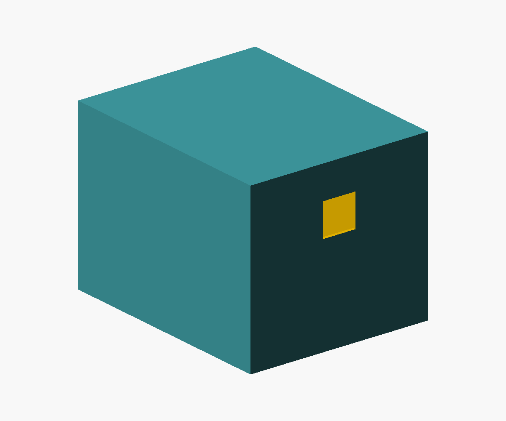

# Rectangular 50 mm MicroHuli body

A separate, single-piece cover with a flat closed top and open bottom. The
original cover and the larger four-part enclosure remain available.



- Outside: **55 mm wide × 68 mm deep × 50 mm high**.
- Inside: **53 × 66 × 48.4 mm**, with 1 mm walls and a 1.6 mm top.
- Rear USB opening: **10 × 10 mm**, centered across the back. Its upper edge
  is **10 mm below the outside top**, so it occupies 30–40 mm above the bottom.
- Solid rectangular walls; no sloping roof, honeycomb, internal mounts or
  fasteners. Chassis retention and actual connector alignment are unverified.

This keeps the original cover's outside footprint. It does **not** provide the
larger enclosure's battery/shield layout: a 60 × 50 mm shield and holder need a
physical layout check inside the 53 × 66 mm cavity, including plugs and wires.
A 10 mm square opening may also be too small for some USB connector housings;
measure the cable before printing.

## Export and print

From the repository root, with OpenSCAD installed:

```sh
mkdir -p hardware/MicroHuli/enclosure/exports
openscad --export-format binstl \
  -o hardware/MicroHuli/enclosure/exports/MicroHuli_body_50mm.stl \
  hardware/MicroHuli/enclosure/body-50mm.scad
```

The default export places the **flat closed top on the print bed**, with the
open bottom facing upward. Start with a 0.4 mm nozzle and 0.2 mm layer height;
inspect the sliced 1 mm walls and the short bridge over the USB opening.
Internal supports should not be needed in this orientation. Physical fit and
print strength have not been tested.

Set `print_orientation=false` to view the body upright. Dimensions and hole
position are editable in [body-50mm.scad](body-50mm.scad).
