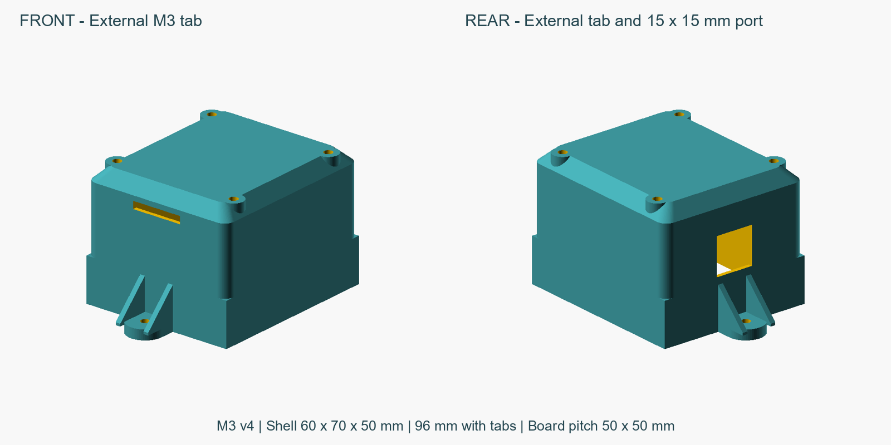
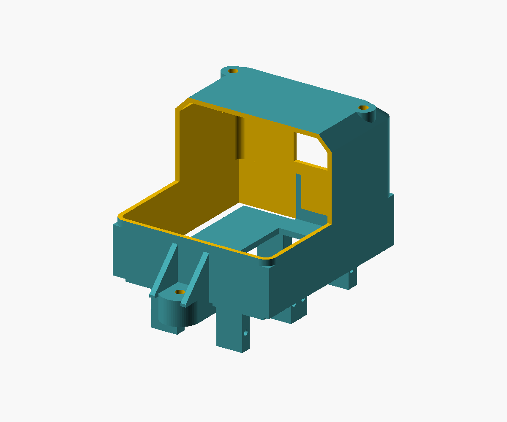

# MicroHuli body with a small sloped roof edge

This is the corrected body requested after the raised-rim interpretation was
rejected. The main shell is **60 × 70 × 50 mm**, including the roof.
It has a **closed top**, a small **5 mm sloped shoulder** like the original
cover, softly rounded upper plan corners, and an open bottom for the chassis.
The current **M3 v4** revision puts both chassis fasteners on external front/rear
tabs. The chassis is assembled with its **flat plate on top and servo brackets
pointing down**, leaving the body cavity free for components. Four roof standoffs
hold the development board.



- Front OLED cable slot: **20.005 × 3 mm**, 40–43 mm above the bottom. As on
  the original robot, the OLED board mounts outside the body. The cable slot
  is retained; the old sloping recess and a verified OLED fastening method are
  not reproduced.
- Rear USB opening: **15 × 15 mm**, centered, 20–35 mm above the bottom. Its
  upper edge is **15 mm below the top**. Check actual connector alignment.
- Upper walls and flat roof: **1.6 mm**. Lower collar: 1 mm walls with a nominal
  **58 × 68 mm cavity for the first 16 mm**, without internal chassis mounting lugs.
  A short transition joins the square collar to rounded upper corners. The cavity
  narrows beneath the roof shoulder.
- Two external chassis screws: **82 mm apart**, at X=0, Y=±41 mm. Each body tab
  is 4 mm thick and mates with a 5 mm chassis tab. Both have **3.4 mm through
  holes**. The chassis tabs have 5.8 mm across-flats nut pockets open from below.
  External side ribs reinforce the body tabs and leave the screw/tool axes clear.
  The original chassis plate and servo brackets have no holes or cuts added.
- Four board screws: **50 × 50 mm centre-to-centre**, at X=±25, Y=±25 mm.
  Standoffs are 8 mm diameter with 3.4 mm through holes. Their PCB contact plane
  is Z=40 mm, 8.4 mm below the main roof underside. Flat screw-head lands extend
  through the sloped roof shoulder; screw heads sit outside the roof. Local
  relief below the posts clears 7 mm washers/nuts and retains 1.3 mm outer wall.
- The external tabs extend **13 mm beyond each end** of the shell. Body plastic
  envelope is **60 × 96 × 50 mm**, revised chassis is **53 × 96 × 15.996 mm**.
  In assembly, the chassis extends below the body, giving about **66 mm total
  plastic height**, without legs or screw heads. The supplied board hole spacing
  does not establish the board outline,
  populated component envelope, connector alignment or battery/wiring clearance.

## M3 assembly

Use the **M3 v4 body and chassis together**. V3 used internal mounting lugs and
the wrong assembled chassis orientation; do not mix those exports with v4.
Exported STL files are oriented for printing, not assembled positioning.

1. With power disconnected, turn the printed chassis over so the flat plate is
   on top and all servo brackets point down. Its plate top is assembled Z=0;
   the brackets reach approximately Z=-16 mm. The body rim also meets Z=0.
2. Put **two ordinary M3 hex nuts** into the underside pockets of the external
   chassis tabs. All chassis fastener hardware is accessible outside the shell;
   printed nut retention is not assumed.
3. Mount the development board under the roof using **four M3 × 16 mm bolts,
   four M3 nuts and suitable M3 washers**. Bolts enter from outside the roof,
   pass through the standoffs and board, and receive nuts below the PCB. The
   PCB top meets Z=40 mm; orient populated components toward the open bottom
   where possible. Use insulating washers and verify clearance from copper,
   solder and components. The length assumes approximately 1.6 mm PCB thickness;
   dry-fit the hardware and check protruding ends before tightening.
4. Align the external front/rear body and chassis tabs. Insert **two M3 × 12 mm
   bolts with washers from above the body tabs**, into the chassis nuts below.
   Grip to each nut's bearing face is approximately 6.4 mm. Hold the nuts from
   below if necessary and tighten gently. The external ribs clear an 8 mm tool
   envelope above each screw axis.
5. Check USB access through the enlarged rear opening, wire routing, battery
   clearance and leg travel before powering the robot.

**Reprint the revised chassis:** its integral external tabs are required. Drilling
the old chassis does not add these tabs. The current design adds material only
at the front/rear tabs, leaving the original servo bays clear in CAD. Physical
servo, leg and ground clearance still need checking.



## Export and print

Install OpenSCAD and add its directory to PATH. From the repository root:

```sh
python hardware/MicroHuli/enclosure/build_body.py --previews
```

Outputs in `exports/`:

- `MicroHuli_body_M3_v4.stl`: body, roof on the bed.
- `MicroHuli_chassis_M3_v4.stl`: chassis with matching external tabs, flat plate
  on the bed and servo brackets upward. Flip it over for assembly.
- `body_M3_v4_report.json`: mesh, dimensions, mating clearance, port and fastener
  access checks. Generated previews include assembled, cutaway and exploded views.

The body export puts the closed central roof on the bed and the open bottom upward.
The 5 mm shoulder grows outward at approximately 45° in this orientation.
Start with a 0.4 mm nozzle and 0.2 mm layers; inspect wall paths, shoulder
layers, nut-pocket bridges, external tab ribs and both cable openings in the slicer.
The ribs slope toward the walls to support roof-down printing. Support needs,
physical printing, joint strength and component fit have not been verified.

Set `print_orientation=false` for an upright view. Edit parameters in
[body-cute-50mm.scad](body-cute-50mm.scad); `part` selects `body`, `chassis`,
`assembly`, `cutaway` or `exploded`. The earlier flat-top and tall-rim alternatives
are separate files. The external OLED fastening method remains unverified.
