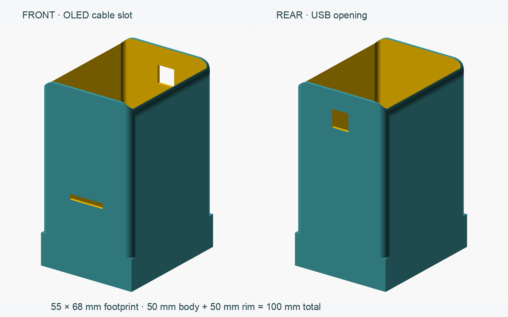

# Rounded MicroHuli body with a raised rim

A separate body-only alternative with softer upper corners and an open top.
The user confirmed a **50 mm raised rim** above the previous 50 mm body:
**total outside height is 100 mm**, with the original **55 × 68 mm footprint**.
There is no closed roof or shelf inside the rim; the bottom is also open for
the chassis. The earlier flat-top cover remains available separately.



## Openings and shape

- Front OLED cable slot: **20.005 × 3 mm**, 40–43 mm above the bottom. This
  restores the original-style narrow passage for an **externally mounted OLED**,
  as shown in the original assembled-robot photo. It is not a screen-sized window.
  The original sloping-face slot is adapted to the new vertical face; mounting
  hardware and the original OLED recess are not reproduced.
- Rear USB opening: **10 × 10 mm**, centered, 80–90 mm above the bottom. Its
  upper edge is 10 mm below the highest top edge, following the taller body.
  Check actual Nano position and the connector housing before printing.
- Upper plan corners have a 4 mm radius; the front/rear upper silhouette corners
  have an 8 mm radius. The lower collar has square corners and a nominal
  **53 × 66 mm cavity for its first 16 mm**; this preserves the original nominal
  clearance without claiming a verified fastening method.
- Lower collar walls are 1 mm; upper walls are 1.6 mm. Above the collar, the
  nominal cavity is 51.8 × 64.8 mm with rounded corners. Check battery, shield,
  plugs and wires in the intended orientation; there are no internal mounts.

## Export and print

```sh
mkdir -p hardware/MicroHuli/enclosure/exports
openscad --export-format binstl \
  -o hardware/MicroHuli/enclosure/exports/MicroHuli_body_cute_rim_50mm.stl \
  hardware/MicroHuli/enclosure/body-cute-rim.scad
```

The STL stands upright on its open bottom. Start with a 0.4 mm nozzle and
0.2 mm layers; inspect the wall paths and bridges above the OLED and USB slots.
A brim may help the tall thin walls adhere. No internal roof needs support.
Physical printing, chassis retention, OLED attachment, cable alignment and
loaded stability have not been tested. This 100 mm body is substantially taller
than the original; test fit before loading the robot.

Edit dimensions in [body-cute-rim.scad](body-cute-rim.scad).
