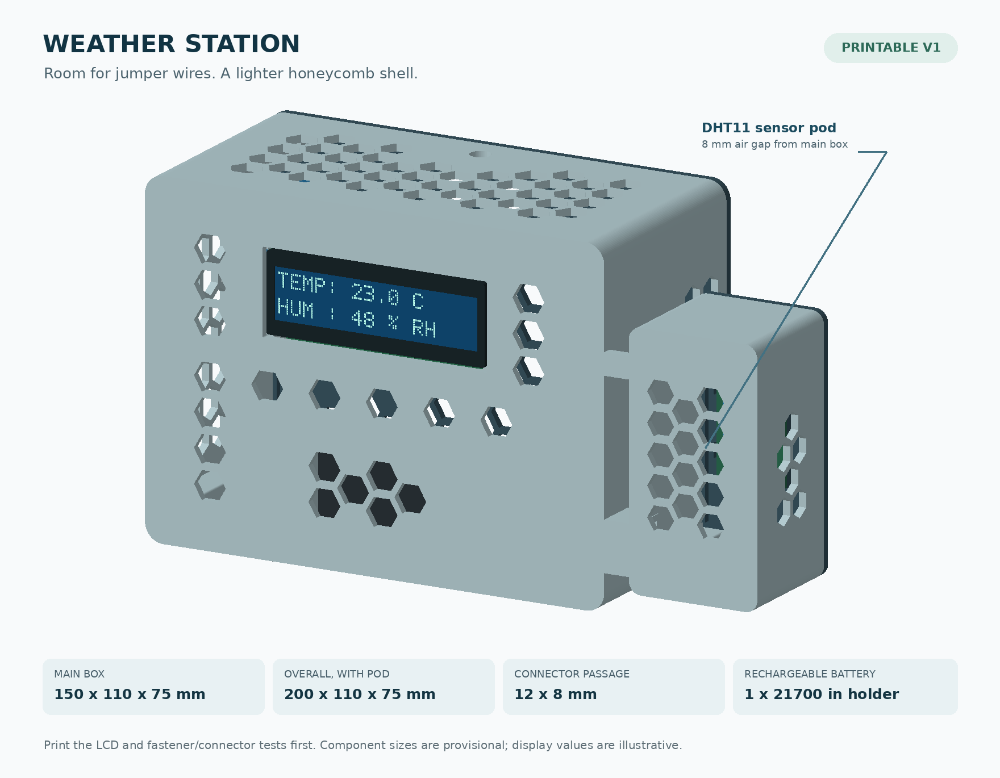

# Weather station hardware

LOLIN ESP32-S2 Mini, DHT11 and bare 16-pin parallel LCD1602A. This hardware project accompanies
[the weather station firmware](../../firmware/weather-station/README.md).

- [Wiring and voltage checks](docs/WIRING.md)
- [Components and pending battery design](docs/COMPONENTS.md)
- [Offline hardware testing](docs/TESTING.md)
- [Parametric enclosure source](enclosure/weather_station_cad.py)

The current station uses the board's outer rows: LCD RS=3, E=5, D4=7, D5=12, D6=33, D7=35;
DHT11 DATA=37. Keep USB CDC enabled. USB power is the active setup; battery, charger and switch
are a future design. Check the actual sensor DATA voltage and LCD input thresholds before use.

## Enclosure sources

`enclosure/` keeps the original V1 CadQuery script, parameters, geometry report, CPU renderer,
guide generator and two reference previews. The previews show the proposed geometry; they do
not establish printed fit or electrical compatibility.



Run the scripts from `enclosure/` in a separate Python environment. The original generator
requires CadQuery 2.7; rendering additionally requires NumPy and Pillow, and the guide requires
ReportLab. They are optional design tools, not server or firmware dependencies.

```sh
python weather_station_cad.py
python render_design.py
python create_guide.py
```

Install DejaVu Sans fonts or set `WEATHER_FONT` and `WEATHER_BOLD_FONT` to local TTF files for
the renderer and guide. Generated `STL/`, STEP, 3MF, PDF, mesh JSON and README.txt are ignored.
The CAD generator writes the mesh JSON required by the renderer. Print the generated LCD and
fastener fit coupons before the enclosure. Existing duplicate meshes and V2 slicer exports were
not imported; these V1 scripts do not reproduce those later manually edited files.
