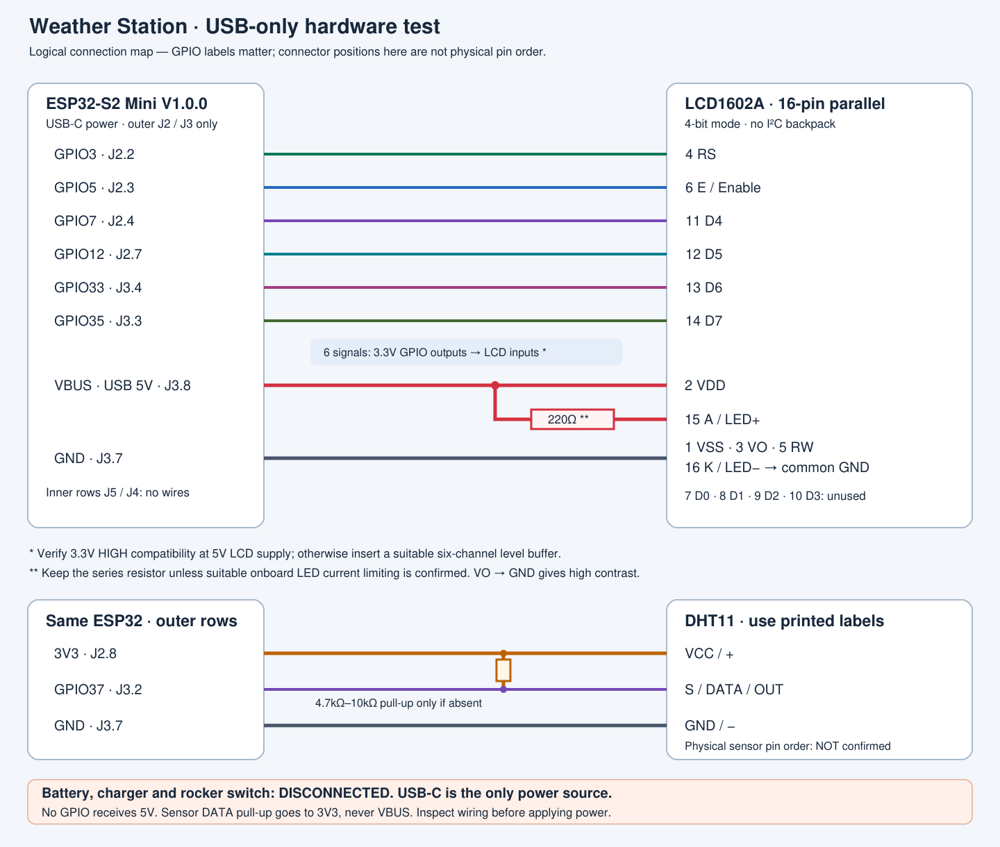

# USB-only hardware test wiring

This wiring applies to the [offline diagnostic](../../../firmware/weather-station/weather_station_test/weather_station_test.ino)
and [main online station](../../../firmware/weather-station/weather_station_online/README.md).
It supersedes the earlier clock firmware's proposed GPIO assignment for the
current hardware test. Use the bare 16-pin parallel LCD, with no I²C backpack.

**Disconnect USB before wiring. Keep the INR21700, charger and rocker switch
disconnected throughout this test. Never connect the cell to 3V3 or VBUS.**

## ESP32-S2 Mini V1.0.0 — outer rows only

The manufacturer schematic groups the four headers as J2–J5–J4–J3. Use the
outer headers **J2 and J3**, leaving **J5 and J4 completely unused**. Check the
actual GPIO/power labels on your board; do not determine a connection from
photograph orientation or socket position alone. Clone markings may differ.

| Function      | Printed GPIO  | Schematic contact | Row   |
| ------------- | ------------- | ----------------- | ----- |
| LCD RS        | 3             | J2 pin 2          | Outer |
| LCD Enable    | 5             | J2 pin 3          | Outer |
| LCD D4        | 7             | J2 pin 4          | Outer |
| LCD D5        | 12            | J2 pin 7          | Outer |
| LCD D6        | 33            | J3 pin 4          | Outer |
| LCD D7        | 35            | J3 pin 3          | Outer |
| DHT11 DATA    | 37            | J3 pin 2          | Outer |
| Sensor power  | 3V3           | J2 pin 8          | Outer |
| Common ground | GND           | J3 pin 7          | Outer |
| LCD power     | VBUS / USB 5V | J3 pin 8          | Outer |

These contacts were checked against the [WEMOS V1.0.0 schematic, lower
header block](https://www.wemos.cc/en/latest/_static/files/sch_s2_mini_v1.0.0.pdf).
The drawing is an electrical reference, not a substitute for checking your
physical board's labels. GPIO37's alternate UART RX function is not used:
this sketch logs over native USB CDC and never starts Serial1 or I²C.

The ESP32 currently has **female sockets**. Use male-ended Dupont jumpers at
the ESP32. Choose the other end for the actual LCD/sensor connector. If a
module has only unsoldered plated holes, push-fit wires are not dependable
contacts: fit a suitable header once or use a proper removable adapter.
Use a breadboard or distribution connector for the shared ground connections;
do not force several jumper pins into one female socket.

## Complete LCD1602A table

Identify LCD pin 1 from its silkscreen or verified module drawing. Do not
assume the numbering direction when viewing the rear of the display.

| LCD pin | Label    | Connection in this test                                                 |
| ------- | -------- | ----------------------------------------------------------------------- |
| 1       | VSS      | ESP32 GND / common ground                                               |
| 2       | VDD      | ESP32 VBUS, powered by USB 5V                                           |
| 3       | VO       | GND; fixed high contrast for the initial test                           |
| 4       | RS       | GPIO3, subject to the input-level check below                           |
| 5       | RW       | **Permanently GND**; no GPIO connection                                 |
| 6       | E        | GPIO5, subject to the input-level check below                           |
| 7       | D0       | Not connected                                                           |
| 8       | D1       | Not connected                                                           |
| 9       | D2       | Not connected                                                           |
| 10      | D3       | Not connected                                                           |
| 11      | D4       | GPIO7, subject to the input-level check below                           |
| 12      | D5       | GPIO12, subject to the input-level check below                          |
| 13      | D6       | GPIO33, subject to the input-level check below                          |
| 14      | D7       | GPIO35, subject to the input-level check below                          |
| 15      | A / LED+ | VBUS through 220Ω unless suitable onboard current limiting is confirmed |
| 16      | K / LED− | GND                                                                     |

No potentiometer is required for this initial test: **VO goes to GND**. This
may produce very dark characters or blocks depending on the module. A 10kΩ
potentiometer can be added later, with outer terminals to VDD/GND and its
wiper to VO. Firmware cannot adjust this hardware contrast connection.

### Backlight current limiting

The actual module's backlight resistor has **not been verified**. Inspect its
markings and circuit/datasheet before applying power. A resistor elsewhere
on the PCB may not limit LED current. If suitable current limiting is absent
or uncertain, put a **220Ω resistor in series between VBUS and LED+** for the
initial test; it may be dimmer if an onboard resistor is also present.
Check the resistor's rating and the module's LED requirements. Never assume
that a generic LCD1602A can connect LED+ directly to 5V.

### 3.3V signals into a 5V LCD

The direct signal connections above assume that the actual LCD's inputs
recognize a 3.3V HIGH when powered at 5V. The original **HD44780U** specifies
VIH ≥ 2.2V for its interface inputs with VCC = 4.5–5.5V ([manufacturer
datasheet, printed page 51](https://www.sparkfun.com/datasheets/LCD/HD44780.pdf#page=51)).
This does **not** identify the controller under your module's epoxy blob.
Its controller variant and input thresholds remain unverified. Check the
actual module documentation; if it does not guarantee this compatibility,
use a suitable unidirectional 3.3V-to-5V level buffer for all six LCD signals.

Grounding RW makes communication write-only so the LCD never drives its
5V data bus back into the ESP32. **No GPIO is connected to VBUS, LCD VDD or
LED+**. Do not add a pull-up from an LCD signal to 5V. Inspect any additional
module circuitry for pull-ups before declaring the real wiring verified.
Software compilation cannot confirm voltages on a physical connection.

## DHT11 — connect by printed labels

**The physical pin order of the user's DHT11 module is not confirmed. Inspect
the labels before applying power. Do not assume the middle pin is positive.**

| Label/function | Connection |
| -------------- | ---------- |
| VCC / +        | ESP32 3V3  |
| S / DATA / OUT | GPIO37     |
| GND / −        | Common GND |

Examples include `S,+,−` (middle is positive) and `+,OUT,−` (middle is DATA).
Other arrangements exist. For a bare four-pin sensor, consult its actual
datasheet and leave its NC contact unused. Verify that the actual breakout
supports a 3.3V supply. Some DHT11 units need 5V for reliable readings; the
user reported this with the pictured module. A 5V supply may also pull DATA
up to 5V, which is outside the ESP32-S2 input specification. Use a suitable
bidirectional 3.3V/5V logic-level shifter on DATA unless the actual circuit
is confirmed to provide 3.3V DATA. The direct wiring table and diagram here
use 3.3V sensor power, without a level shifter. See the
[DHT power guidance](https://learn.adafruit.com/dht/connecting-to-a-dhtxx-sensor)
and [ESP32-S2 DC characteristics, section 5.4](https://www.espressif.com/sites/default/files/documentation/esp32-s2_datasheet_en.pdf).

If the module already has a DATA pull-up, do not add one unnecessarily.
For a bare sensor or a board lacking one, connect **4.7kΩ–10kΩ between DATA
and 3V3**. This is a parallel pull-up, **not a resistor in series with DATA**.
Keep the sensor supply and DATA pull-up at 3.3V. See [Adafruit's connection
guide](https://learn.adafruit.com/dht/connecting-to-a-dhtxx-sensor).

## Connection diagram

[Open the editable SVG diagram](wiring.svg).

The diagram is a logical connection map, not a physical connector-order
drawing. Green/blue/purple traces are individual GPIO signals; red is USB
5V, orange is 3V3, and dark gray is common GND. The six LCD signal traces
are conditional on the input-level check above.

USB-C powers the ESP32, VBUS powers the LCD, and 3V3 powers the DHT11. Keep
the battery, charger and switch completely outside this active circuit.
Continue with [the step-by-step test](TESTING.md) before closing the enclosure.
